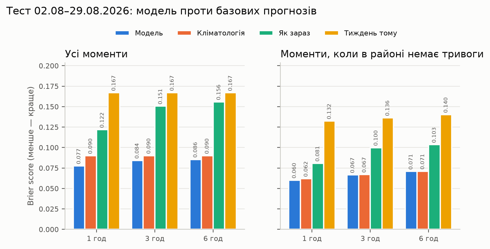
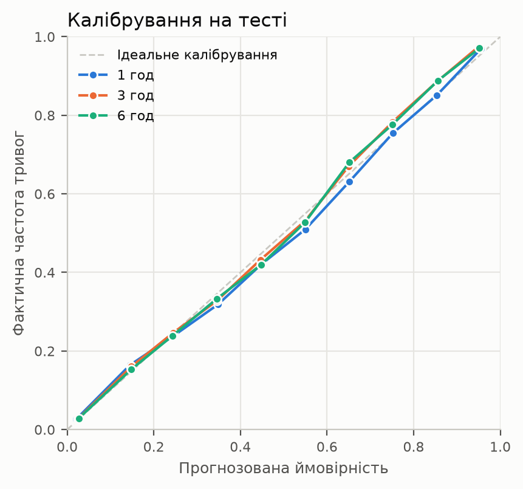
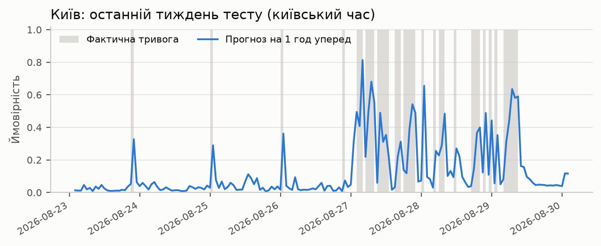

# Прогноз повітряних тривог в Україні

Прогноз ймовірності повітряної тривоги в **районах** України на 1, 3 і 6 годин уперед. Модель враховує, куди загроза може полетіти далі від фронту: тривоги в прифронтових районах — сигнал для тилових.

Головна вимога — **жодного витоку даних**: модель використовує лише те, що було відомо на момент прогнозу, а оцінюється на найсвіжішому доступному періоді.

## Результати MVP

Тест — 02.08–29.08.2026: останні 4 тижні офіційних даних перед збоєм джерела (рішення D-7). 119 районів, прогноз щогодини. Поза ціллю за правилом AC-2.4 — один район: Чорнобильська зона відчуження (тривога лише 0,05% часу на навчальних даних); у Криму, Севастополі й на Луганщині постійна тривога, якої немає в датасеті. Модель навчено на даних 01.11.2025–01.08.2026 з проміжком у h годин перед тестом; тестовий період модель не бачила.

**Brier score** (основна метрика, менше — краще) і ROC-AUC:

| Горизонт | Модель | Кліматологія | Як зараз | Тиждень тому |
|---|---|---|---|---|
| 1 год | **0,077** (AUC 0,941) | 0,090 (0,923) | 0,122 (0,836) | 0,167 (0,772) |
| 3 год | **0,084** (AUC 0,930) | 0,090 (0,923) | 0,151 (0,797) | 0,167 (0,772) |
| 6 год | **0,086** (AUC 0,926) | 0,090 (0,923) | 0,156 (0,790) | 0,167 (0,772) |

Базові прогнози: «кліматологія» — частота тривог у районі в цю годину доби на даних до тесту; «як зараз» — стан тривоги в момент прогнозу; «тиждень тому» — стан у той самий час тиждень тому. Усі метрики, зокрема за підмножинами, — у [outputs/metrics/metrics.csv](outputs/metrics/metrics.csv).



**Що це означає:**

- Модель краща за всі базові прогнози на всіх горизонтах; найбільший виграш — на 1 год.
- Ймовірності майже ідеально відкалібровані: прогноз «40%» справджується приблизно в 40% випадків.
- У тилових районах модель помітно краща за кліматологію (ROC-AUC 0,87 проти 0,81 на 1 год), тобто ознаки поширення загрози від сусідніх районів працюють. У прифронтових: Brier 0,126 проти 0,155.
- **Чесне обмеження:** коли в районі зараз немає тривоги, модель лише трохи краща за кліматологію на 1 год (0,060 проти 0,062), а на 3 і 6 год — на тому ж рівні. Виграш дає переважно динаміка тривог, що вже тривають; передбачити початок нової тривоги понад добовий ритм за самою історією тривог важко. Саме тут мають допомогти дані моніторингових каналів — наступний етап.





Прогноз на останній момент тестового періоду у форматі контракту для веб-інтерфейсу — [outputs/export/forecast.json](outputs/export/forecast.json).

## Документація

Усі рішення спершу фіксуємо в документах, а потім реалізуємо в коді.

| Документ | Що в ньому |
|---|---|
| [JOB_STORIES.md](JOB_STORIES.md) | Сценарії (Job Stories), критерії приймання у форматі Given/When/Then (AC-x.y), рішення (D-x), відомі обмеження, джерела даних і список Telegram-каналів |
| [INFORMATION_ARCHITECTURE.md](INFORMATION_ARCHITECTURE.md) | Модель даних: сутності й ключі, словники, часова модель і межі вибірок, шари даних, контракт для інтерфейсу |
| [QA_LOG.md](QA_LOG.md) | Журнал QA: що перевірено після кожного кроку, що пішло не так і як це виправили |
| [CLAUDE.md](CLAUDE.md) | Правила роботи для AI-асистента (Claude Code): QA після кожного кроку, git, мовне правило |
| [AI_LOG.md](AI_LOG.md) | Читабельний експорт розмови з AI-асистентом (Claude Code), у якій створено проєкт: повідомлення, відповіді й виклики інструментів |

Код посилається на документацію за ID: коментар `# AC-5.6` означає, що рядок реалізує цей критерій, а `config.py` містить значення з рішень D-1…D-7.

## Як це працює

1. **Довідники** (`reference.py`): межі й коди 139 районів з OCHA COD-AB, сусідство (перше й друге кільце), зведення назв районів із CSV тривог до кодів, зокрема трьох районів, перейменованих у 2024 р.
2. **Сітка** (`pipeline.py`): тривоги очищено від дублікатів (38% рядків), перекриті інтервали об'єднано, обласні тривоги поширено на всі райони області. Для кожного району й години — чи активна тривога і скільки нових тривог почалося за попередню годину.
3. **Ознаки станом на T**: історія району (6, 24, 168 год), тривалість поточної тривоги, сусіди першого й другого кільця, частка районів області під тривогою, нові тривоги в радіусі 200 км за 1 і 3 год, відстань до найближчої активної тривоги, стан країни, година й день тижня за київським часом.
4. **Модель**: `HistGradientBoostingClassifier` (scikit-learn), окремо для кожного горизонту; район — категорійна ознака.

## Захист від витоку даних

Повний перелік критеріїв — JS-5 в [JOB_STORIES.md](JOB_STORIES.md). У коді:

- ознаки в рядку T використовують лише рядки до T включно; для тривоги, що триває, використовується лише те, що відбою ще не було;
- **автотест** [tests/test_leakage.py](tests/test_leakage.py): видаляємо всі події після T, а кінець тривог, що тривають, робимо невідомим — ознаки на T і раніше мають лишитися тими самими;
- train → test ідуть за часом, між ними — проміжок у h годин; частоти для базових прогнозів рахуються лише на даних до тесту;
- години, на які припадає збій джерела (30.08–01.09.2026), не використовуються як ціль.

## Дані

- **Тривоги:** офіційний датасет [Vadimkin/ukrainian-air-raid-sirens-dataset](https://github.com/Vadimkin/ukrainian-air-raid-sirens-dataset) (ліцензія MIT), з 15.03.2022. З кінця 2025 р. тривоги оголошують переважно по районах. Датасет перестав оновлюватися 07.09.2026.
- **Межі й коди районів:** [OCHA COD-AB Ukraine](https://data.humdata.org/dataset/cod-ab-ukr), джерело — ДНВП «Картографія», ліцензія CC BY-IGO. Крим і Севастополь — у складі України.
- **Мова:** лише україномовні джерела (рішення D-11).

Статус і перевірка кожного джерела — у додатку A в [JOB_STORIES.md](JOB_STORIES.md).

## Запуск

Потрібен Python 3.12 або новіший (перевірено на 3.13).

```bash
python3 -m venv .venv
.venv/bin/pip install -r requirements.txt
.venv/bin/pip install -e . --no-deps
.venv/bin/python -m airalert.reference   # завантажує CSV тривог і межі COD-AB, будує довідники
.venv/bin/python -m airalert.pipeline    # сітка, ознаки, модель, метрики, forecast.json (~20 с)
.venv/bin/python -m airalert.figures     # графіки WebP
.venv/bin/python -m pytest               # тести, зокрема автотест на витік даних
```

Ключі Telegram для MVP не потрібні.

## Стан роботи

| Етап | Стан |
|---|---|
| Каркас, документація, QA | ✅ |
| Довідники: межі COD-AB, коди районів, сусідство | ✅ |
| Очистка тривог, сітка «район × година», ознаки, автотест на витік даних | ✅ |
| Базові прогнози, модель, метрики, графіки WebP, `forecast.json` | ✅ |
| Свіжі дані до поточної дати (власний розбір каналу @air_alert_ua) | далі |
| Веб-портал із картою районів | далі |
| Ознаки з моніторингових Telegram-каналів у реальному часі | далі |

**Не встигли в MVP:** історична ймовірність переходу тривоги між районами (частина AC-6.6), тривоги рівня громади як ознаки (D-14), підбір гіперпараметрів на validation, межі в GeoJSON для інтерфейсу. Подробиці — у [QA_LOG.md](QA_LOG.md).

## Структура

```
src/airalert/          config.py — шляхи, джерела, межі вибірок; sources.py — завантаження з маніфестом;
                       reference.py — довідники; pipeline.py — сітка, ознаки, модель; figures.py — графіки
tests/                 тести: межі вибірок, документація, витік даних
data/reference/        довідники (у git)
data/raw/              сирі дані + manifest.json (не в git, відтворюються скриптами)
outputs/metrics/       метрики й список районів у цілі (у git)
outputs/export/        forecast.json для інтерфейсу (у git)
reports/figures/       графіки WebP (у git)
```

## Технології

Python 3.13; pandas і NumPy для MVP-пайплайну (Polars і DuckDB — у залежностях для наступних етапів); scikit-learn (`HistGradientBoostingClassifier`); GeoPandas; matplotlib (WebP без втрат). LightGBM не використовуємо: на macOS він потребує системної бібліотеки `libomp`.

## Пов'язані роботи

- [Pavlyshenko & Pavlyshenko, Predictive Analytics of Air Alerts in the Russian-Ukrainian War (arXiv, 2024)](https://arxiv.org/html/2411.14625v1): ознаки сусідніх регіонів і сезонності для прогнозу тривог.
- [Neptun](https://neptun.in.ua/): реєстр моніторингових Telegram-каналів, з якого взято кандидатів для текстового шару.
